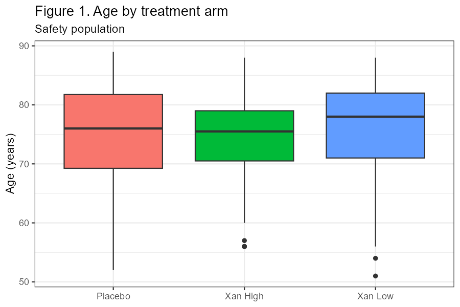
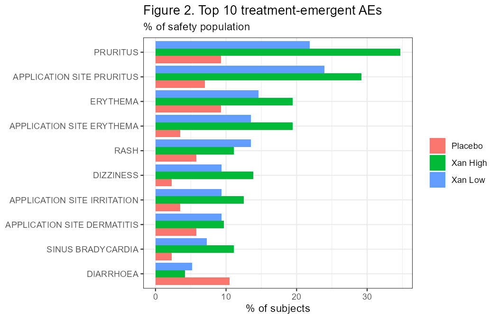

```{r setup, include=FALSE}
knitr::opts_chunk$set(echo = FALSE, warning = FALSE, message = FALSE)
library(DBI)
library(knitr)
 setwd("~/Fran/R_CDISC_Pilot")
db   <- dbConnect(RSQLite::SQLite(), "SDTM_study.sqlite")
t1   <- dbReadTable(db, "TFL_T1_DEMOG")
t2   <- dbReadTable(db, "TFL_T2_TOP_AE")
dbDisconnect(db)
```

## Table 1. Demographics (safety population)

```{r t1}
kable(t1, col.names = c("", names(t1)[-1]))
```

## Table 2. Top 10 treatment-emergent adverse events

Subjects, n (%). Percentages use the safety-population N per arm.

```{r t2}
kable(t2, col.names = c("Preferred term", names(t2)[-1]))
```

\newpage

## Figure 1. Age by treatment arm

```{r f1, out.width="80%", fig.align="center"}

```

## Figure 2. Top 10 treatment-emergent AEs by arm

```{r f2, out.width="90%", fig.align="center"}

```

*Source: `study.sqlite`, pipeline run `r meta$run_id`. Lineage: RAW to SDTM to ADSL to TFL.*